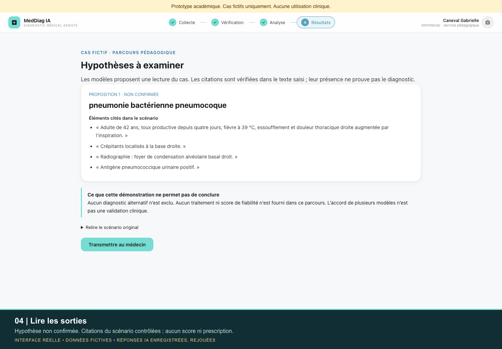

# MedDiag IA

Prototype académique de Gabrielle Caneval : interface Next.js/React, API FastAPI et orchestration de modèles Groq avec LangGraph.

## Fonctionnement

1. Saisie d’un cas fictif et structuration de l’entrée.
2. Préparation du contexte et analyse préliminaire de ses limites.
3. Deux appels LLM en parallèle, suivis d’un troisième appel d’arbitrage.
4. Affichage pédagogique des hypothèses, citations vérifiées et relecture simulée.

Le parcours pédagogique est activé par défaut. [Corrections, contrôles et limites détaillés](docs/demo-review.md).

La sélection infirmier/médecin et la validation sont des états de l’interface : elles ne constituent ni une authentification ni un contrôle d’autorisation serveur. Les résultats ne sont pas validés cliniquement. Le nouveau parcours ne présente aucun score ni prescription. Les fonctions historiques restent non validées et sont distinguées dans la documentation.

## Lancement local

Python 3.10+ et Node.js 20.9+ sont requis.

```sh
python3 -m venv .venv
source .venv/bin/activate
pip install -r requirements.txt
cp .env.example .env
# Renseigner sa propre clé GROQ_API_KEY dans .env
uvicorn main:app --reload --port 8000
```

Dans un second terminal :

```sh
cd frontend
npm ci
cp .env.example .env.local
npm run dev
```

Ouvrir http://localhost:3000. API : http://localhost:8000/docs. Les appels nécessitent une clé Groq valide et des modèles accessibles sur le compte utilisé. Ils peuvent consommer le quota de ce compte.

## Périmètre et limites

- Démonstration uniquement avec des cas fictifs, sans données personnelles.
- Aucun usage clinique, aucune garantie diagnostique ou conformité HDS revendiqués.
- L’application envoie les entrées soumises aux modèles externes Groq. Elle ne contient pas de mécanisme de pseudonymisation ni de journal d’audit.
- La validation humaine n’est pas imposée par le backend ; le prototype ne doit pas être exposé publiquement avec une clé API.
- La lecture vocale et la caméra dépendent des permissions et capacités du navigateur. L’analyse d’images nécessite un modèle compatible configuré avec MEDDIAG_VISION_MODEL ; elle est désactivée par défaut. Les PDF ne sont pas convertis en images.
- Les exports sont des sorties de démonstration, pas des documents médicaux officiels.
- Aucun modèle n’est entraîné dans ce dépôt. La disponibilité des identifiants de modèles doit être vérifiée auprès du fournisseur.

## Démonstration vidéo

[](docs/media/meddiag-demo.mp4)

[Lire ou télécharger la vidéo MP4 (54 secondes)](docs/media/meddiag-demo.mp4).

Enregistrement de l’interface réelle avec Caneval Gabrielle comme nom de démonstration et un patient fictif. Les réponses du cas de pneumonie ont réellement été obtenues via Groq puis rejouées sans modification pendant la capture. Il montre la collecte, la structuration, les résultats, la transmission locale du dossier et sa relecture pédagogique simulée. Les citations sont contrôlées par rapport au texte saisi ; les hypothèses ne sont pas des conclusions médicales. Vidéo muette avec explications incrustées, [sous-titres français](docs/media/meddiag-demo.fr.vtt) et [description du parcours](docs/demo-video.md).

## Vérification technique

`python -m unittest discover -s tests -v` contrôle le contexte LangGraph, la conservation de la source originale, le rejet des citations inventées, des champs supplémentaires et des arbitrages invalides, avec appels LLM simulés. Le frontend a été compilé avec `npm run build`. Aucun diagnostic réel n’a été validé.

## Droits

Code consultable, tous droits réservés. Voir [LICENSE](LICENSE).
